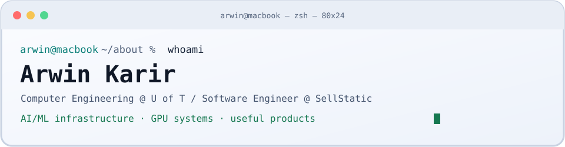
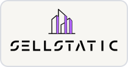

  <picture>
    <source media="(prefers-color-scheme: dark)" srcset="https://raw.githubusercontent.com/Arwin-K/Arwin-K/main/assets/terminal-hero.svg" />
    <source media="(prefers-color-scheme: light)" srcset="https://raw.githubusercontent.com/Arwin-K/Arwin-K/main/assets/terminal-hero-light.svg" />
    
  </picture>

Computer Engineering at the University of Toronto · Toronto, Canada

I build software across the stack, from useful product features to machine learning and GPU systems. I care about making ideas work well in real use.

## What I'm building

- **[Still](https://still-testing.vercel.app/)** — A place to find people to build open-source projects with after hackathons. [Try it](https://still-testing.vercel.app/).
- **[Jev](https://github.com/Arwin-K/jev-llm-gateway)** — An LLM gateway research project studying model routing, answer quality, and serving costs.
- **[CUDA Fused Causal Softmax](https://github.com/Arwin-K/cuda-attention-softmax)** — A CUDA operator and reproducible study of GPU performance for transformer attention.
- **[Altman Meter](https://github.com/Arwin-K/altman-meter)** — A Mac menu bar app and desktop widget for RAM, disk, and battery.

## Experience

<table>
  <tr>
    <td align="center" width="150"></td>
    <td><strong>Software Engineer · SellStatic</strong> Building AI advertising tools with React, C#/.NET, AWS, and Azure.</td>
  </tr>
  <tr>
    <td align="center" width="150"></td>
    <td><strong>Artificial Intelligence Intern · Amazon</strong> Worked on a forest-cover classification pipeline.</td>
  </tr>
</table>

## Languages, frameworks & tools

**Product — interfaces, APIs, databases**  
<picture>
  <source media="(prefers-color-scheme: dark)" srcset="https://skillicons.dev/icons?i=ts,js,react,vite,cs,dotnet,postgres,mongodb&amp;theme=dark" />
  <source media="(prefers-color-scheme: light)" srcset="https://skillicons.dev/icons?i=ts,js,react,vite,cs,dotnet,postgres,mongodb&amp;theme=light" />
  
</picture>

**ML & systems — training, inference, vision, GPU work**  
<picture>
  <source media="(prefers-color-scheme: dark)" srcset="https://skillicons.dev/icons?i=python,cpp,pytorch,opencv,raspberrypi,linux&amp;theme=dark" />
  <source media="(prefers-color-scheme: light)" srcset="https://skillicons.dev/icons?i=python,cpp,pytorch,opencv,raspberrypi,linux&amp;theme=light" />
  
</picture>  
CUDA · ONNX · scikit-learn · NumPy · pandas

**Infrastructure — cloud, containers, tooling**  
<picture>
  <source media="(prefers-color-scheme: dark)" srcset="https://skillicons.dev/icons?i=aws,azure,docker,git,github&amp;theme=dark" />
  <source media="(prefers-color-scheme: light)" srcset="https://skillicons.dev/icons?i=aws,azure,docker,git,github&amp;theme=light" />
  
</picture>  
SNS/SQS · Lambda · SageMaker · CI · profiling and benchmarks

Outside of work, I enjoy photography, comics, and a good sunset.

[Portfolio](https://arwink.me) · [LinkedIn](https://www.linkedin.com/in/arwin-karir/) · [Email](mailto:karirarwin@gmail.com) · [Photography](https://www.instagram.com/karir.visuals/)
